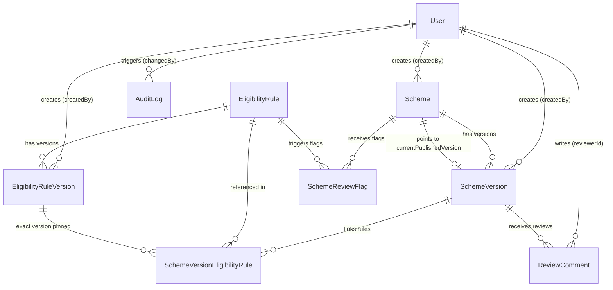
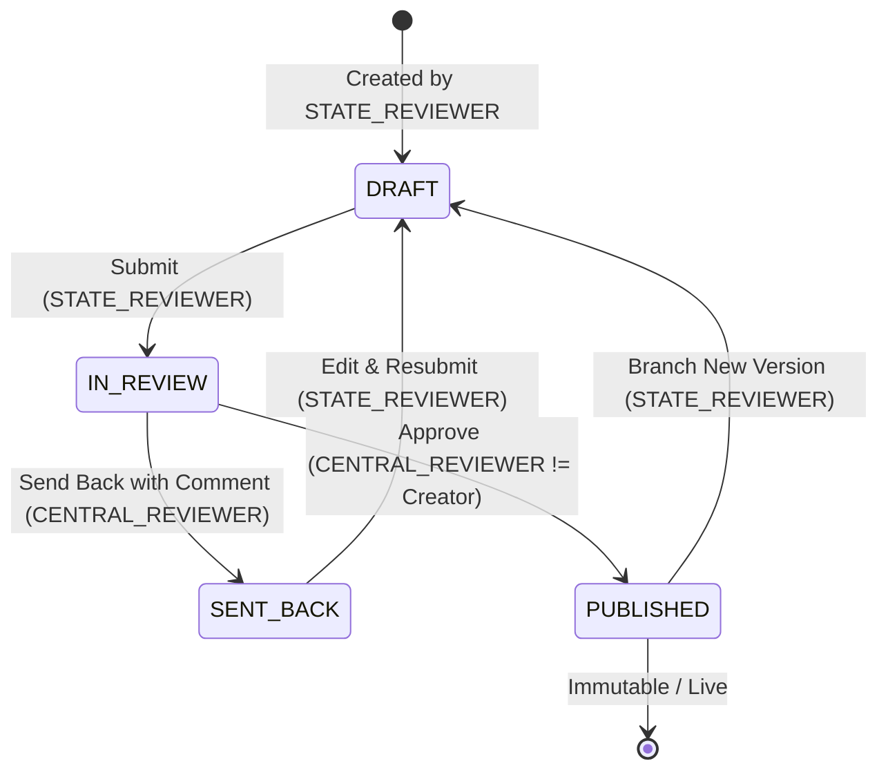

# Government Scheme Management System

Backend Scheme Management System with Immutable Version Control, Role-Based Approval Workflow, Shared Eligibility Rules, and Field-Level Audit Logging.

---

## 1. Project Overview & Business Problem

Governments roll out hundreds of social welfare schemes (financial aids, pensions, educational stipends, agricultural subsidies) across state and central departments. In real-world governance, two critical operational problems frequently arise:

1. **Unintentional Breaking Changes & Version Drift:** When eligibility criteria change (e.g., income threshold revised from ₹2.5 Lakh to ₹3.0 Lakh due to inflation), directly editing the live scheme risks silently breaking eligibility evaluations for ongoing applicants or altering citizen entitlements unexpectedly.
2. **Review Integrity & Concurrency:** Different roles (State Reviewer vs. Central Reviewer) collaborate on drafting, fine-tuning, and sanctioning welfare schemes. State Reviewers must not be able to approve their own submissions, drafts under review must never be visible to field agents or citizens querying live schemes, and any modification to numbers, dates, or rule links must be immutably auditable.

This backend application solves these challenges by implementing:
- **Strict Immutable Scheme Versioning:** Published schemes are permanently immutable. Any update requires creating an isolated new version.
- **Pointer-Based Live Read API:** The public/citizen API accesses schemes strictly through `Scheme.currentPublishedVersionId`, ensuring drafts, in-review, or sent-back versions are never prematurely exposed.
- **Four-Eyes Approval Workflow (`DRAFT → IN_REVIEW → PUBLISHED / SENT_BACK`):** Central Reviewers validate submissions, with hard enforcement preventing creators from approving their own versions.
- **Shared Decoupled Eligibility Rules:** Logical rules (e.g., Annual Family Income Limit) are defined as independent versioned entities. Updating a rule automatically creates **Pending Review Flags** for all affected schemes without altering live schemes until each scheme is consciously re-drafted, submitted, and approved.
- **Field-Level Audit Logging:** Every delta between previous and current field states (`oldValue` vs `newValue`) is recorded with user attribution and timestamp within transactional boundaries.

---

## 2. Technology Stack

- **Runtime & Language:** Node.js (v22.x LTS), TypeScript (Strict Mode)
- **Web Framework:** Express.js (Modular Router architecture)
- **Database & ORM:** PostgreSQL (v16/18), Prisma ORM
- **Security:** Helmet, CORS, Express-Rate-Limit, BCrypt (Password Hashing), JSON Web Tokens (JWT)
- **Validation:** Zod (Strict schema validation for Body, Params, and Query)
- **Documentation:** Swagger UI / OpenAPI 3.0 (`/api-docs`)
- **Testing:** Jest, Supertest, TS-Jest (34 test cases covering 100% of Phase 10 requirements)
- **Code Quality:** ESLint, Prettier

---

## 3. System Architecture & Folder Structure

```
scheme-management-system/
├── prisma/
│   ├── schema.prisma            # PostgreSQL schema with UUID keys, indexes, and relations
│   ├── seed.ts                  # Idempotent synthetic database seed
│   └── migrations/              # Production-grade SQL migration history
├── src/
│   ├── config/
│   │   ├── env.ts               # Type-safe environment variable parsing with Zod
│   │   ├── database.ts          # Singleton Prisma Client instance
│   │   └── swagger.ts           # OpenAPI 3.0 specification config
│   ├── common/
│   │   ├── enums/               # Role, SchemeStatus, ReviewAction, ReviewFlagStatus
│   │   ├── constants/           # HTTP status codes, audit sources
│   │   ├── types/               # AuthenticatedUser, API Response, Pagination interfaces
│   │   └── utils/               # AppError class, ResponseFormatter standardizer
│   ├── middlewares/
│   │   ├── authenticate.middleware.ts  # JWT extraction, signature verify, user resolution
│   │   ├── authorize.middleware.ts     # Role-based access control (RBAC)
│   │   ├── validate.middleware.ts      # Zod request validator
│   │   ├── error.middleware.ts         # Centralized error handler & status mapper
│   │   └── not-found.middleware.ts     # Standardized 404 handler
│   ├── modules/
│   │   ├── auth/                       # User login, registration, /me
│   │   ├── users/                      # User querying and reviewer directory
│   │   ├── schemes/                    # Scheme creation, public read, list & history
│   │   ├── scheme-versions/            # Version creation, updates, and workflow triggers
│   │   ├── eligibility-rules/          # Reusable shared rules and dependent scheme queries
│   │   ├── audit-logs/                 # Field-level change audit trails
│   │   ├── review-comments/            # Approver & reviewer feedback commentary
│   │   └── review-flags/               # System-generated rule update review flags
│   ├── routes/
│   │   └── index.ts                    # Consolidated /api/v1 router mount
│   ├── app.ts                          # Express application setup
│   └── server.ts                       # HTTP server bootstrap and graceful shutdown
├── tests/
│   ├── setup.ts                        # Jest database lifecycle hook
│   ├── unit/                           # AppError and ResponseFormatter unit tests
│   └── integration/                    # Complete integration suite (Cases 1 - 42)
├── docker-compose.yml                  # PostgreSQL container definition
├── .env.example                        # Environment template
├── tsconfig.json                       # Strict TypeScript configuration
├── package.json
└── README.md
```

---

## 4. Database Entities and Relationships



### Entity Specifications
1. **User:** Stores reviewers with hashed passwords (`Role.STATE_REVIEWER`, `Role.CENTRAL_REVIEWER`).
2. **Scheme:** Represents permanent scheme identity (`schemeCode` unique). Holds `currentPublishedVersionId` pointer.
3. **SchemeVersion:** Contains editable or snapshot data (`schemeName`, `description`, `amount`, `applicationDeadline`, `status`, `submittedAt`, `publishedAt`). Unique constraint on `(schemeId, versionNumber)`.
4. **EligibilityRule:** Represents logical criteria (e.g., `RULE_INCOME_250K`) and points to `latestVersionId`.
5. **EligibilityRuleVersion:** Immutable JSON rule definition (`field`, `operator`, `value`, `unit`). Unique on `(eligibilityRuleId, versionNumber)`.
6. **SchemeVersionEligibilityRule:** Junction table pinning a scheme version to an **exact rule version** (`eligibilityRuleVersionId`).
7. **AuditLog:** Records every field-level delta (`fieldName`, `oldValue`, `newValue`, `changedBy`, `source`).
8. **ReviewComment:** Stores feedback and decision history (`action: APPROVED | SENT_BACK`).
9. **SchemeReviewFlag:** Flags schemes that require review due to upstream eligibility rule updates (`status: PENDING | RESOLVED`).

---

## 5. Scheme Lifecycle & Workflow



### Workflow Rules:
1. **DRAFT:** Initial state when created by a `STATE_REVIEWER`.
2. **IN_REVIEW:** Only `STATE_REVIEWER` can submit. Marks `submittedAt`.
3. **SENT_BACK:** `CENTRAL_REVIEWER` returns the version. A non-empty comment is mandatory. The author can edit and resubmit.
4. **PUBLISHED:** Only `CENTRAL_REVIEWER` can approve. **Self-approval is strictly forbidden** (`version.createdBy !== reviewer.id`).
5. **Atomic Publication:** In a single transaction:
   - Sets status to `PUBLISHED` and `publishedAt = now()`.
   - Adds an `APPROVED` review comment.
   - Updates `Scheme.currentPublishedVersionId`.
   - Resolves any corresponding `PENDING` review flags for updated rules adopted by this version.
   - Writes field-level audit entries.

---

## 6. Shared Eligibility Rules & Decoupling

When a shared rule changes:
1. A new version of `EligibilityRuleVersion` is appended (e.g., Version 2).
2. Existing scheme versions are **not modified**—their junction table continues pointing to Version 1.
3. The system generates a `PENDING` `SchemeReviewFlag` for every scheme using this rule.
4. When a `STATE_REVIEWER` creates a new scheme version, they can explicitly adopt the new rule version.
5. When that new scheme version is published, its corresponding `SchemeReviewFlag` is automatically resolved.

---

## 7. API Endpoints Reference

### Authentication
- `POST /api/v1/auth/register` — Register a reviewer (Rate limited)
- `POST /api/v1/auth/login` — Login with email and password (Rate limited)
- `GET /api/v1/auth/me` — Get current authenticated user profile

### Schemes & Versions
- `GET /api/v1/schemes` — List schemes (Public returns published only; Reviewers see drafts)
- `GET /api/v1/schemes/:schemeId` — Scheme details (Public returns published; Reviewers see versions & flags)
- `GET /api/v1/schemes/public/:schemeId` — Explicit public read endpoint for current published version
- `GET /api/v1/schemes/:schemeId/history` — Complete version and review comment history
- `POST /api/v1/schemes` — Create initial scheme draft (STATE_REVIEWER)
- `POST /api/v1/schemes/:schemeId/versions` — Create a new version for an existing scheme (STATE_REVIEWER)
- `PATCH /api/v1/schemes/:schemeId/versions/:versionId` — Edit draft / sent-back version (STATE_REVIEWER)
- `POST /api/v1/schemes/:schemeId/versions/:versionId/submit` — Submit draft for review (STATE_REVIEWER)
- `POST /api/v1/schemes/:schemeId/versions/:versionId/approve` — Approve and publish version (CENTRAL_REVIEWER)
- `POST /api/v1/schemes/:schemeId/versions/:versionId/send-back` — Send back version with comments (CENTRAL_REVIEWER)

### Shared Eligibility Rules
- `POST /api/v1/eligibility-rules` — Create a new rule with Version 1
- `GET /api/v1/eligibility-rules` — List all rules with versions
- `GET /api/v1/eligibility-rules/:ruleId` — Get rule by ID
- `PATCH /api/v1/eligibility-rules/:ruleId` — Update rule (Appends new version and flags dependent schemes)
- `GET /api/v1/eligibility-rules/:ruleId/schemes` — List all schemes referencing this rule

### Audit Logs & Review Comments
- `GET /api/v1/schemes/:schemeId/audit-logs` — Paginated field-level audit logs for a scheme
- `GET /api/v1/audit-logs` — Global audit logs with entity and author filters
- `GET /api/v1/review-comments/versions/:versionId/comments` — Review comments for a version
- `GET /api/v1/review-flags` — Query pending or resolved scheme review flags
- `PATCH /api/v1/review-flags/:id/resolve` — Manually resolve a review flag

### Health & Documentation
- `GET /health` — Application health check
- `GET /api-docs` — Swagger UI API Documentation

---

## 8. Sample Credentials (Development & Testing)

| Role | Email | Password |
|---|---|---|
| **STATE_REVIEWER 1** | `state.reviewer1@example.gov` | `Password@123` |
| **STATE_REVIEWER 2** | `state.reviewer2@example.gov` | `Password@123` |
| **CENTRAL_REVIEWER 1** | `central.reviewer1@example.gov` | `Password@123` |
| **CENTRAL_REVIEWER 2** | `central.reviewer2@example.gov` | `Password@123` |

---

## 9. Installation & Execution Guide

### Prerequisites
- Node.js >= 20.x (tested on v22.12.0)
- PostgreSQL (Local or Docker container)

### Step 1: Environment Setup
```bash
cp .env.example .env
```
Ensure `DATABASE_URL` in `.env` matches your PostgreSQL instance.

### Step 2: Install Dependencies
```bash
npm install
```

### Step 3: Run Database Migrations
```bash
npm run prisma:generate
npm run prisma:migrate
```

### Step 4: Seed Database (Idempotent)
```bash
npm run prisma:seed
```

### Step 5: Run Development Server
```bash
npm run dev
```
- API Base URL: `http://localhost:5000/api/v1`
- Swagger Documentation: `http://localhost:5000/api-docs`
- Health Check: `http://localhost:5000/health`

### Step 6: Run Tests
```bash
npm test
```

---

## 10. Assignment Walkthrough Questions

### Question 1: Explain versioning to a non-technical programme head.

> Think of a government scheme as a published official gazette notification or physical policy handbook. Once it is stamped, signed, and distributed to district welfare officers across the state, you cannot use an eraser and pen to secretly change the subsidy amount or income limit on the existing printed book. If officers or citizens need updated rules, the department drafts a brand new edition (Version 2). While Version 2 is being prepared, debated, and reviewed at the Secretariat, officers on the ground continue to accept and evaluate applications strictly against the approved Version 1. Only after the Minister and Secretary officially sign off on Version 2 does it become the active handbook for the public. The older Version 1 is never destroyed; it is preserved in the state archives so past approvals can always be audited.

### Question 2: What could break first at 5,000 schemes?

At **5,000 schemes** with multiple versions each (e.g., 25,000 scheme versions and 500,000+ applicants/audit entries):

1. **Audit Log Table Growth:** The `audit_logs` table logs every modified field (`oldValue` vs `newValue`). With frequent updates, this table quickly grows to millions of rows. **Remedy:** Implement table partitioning by `createdAt` (monthly/quarterly) and add composite B-tree indexes on `(entityType, entityId, createdAt)`.
2. **Junction Table Joins on Public Read:** Querying schemes with nested eligibility rules and rule versions could become slow if joining across unindexed foreign keys. **Remedy:** Composite indexing on `(schemeVersionId, eligibilityRuleId)` and caching the resolved published version snapshot in Redis.
3. **Rule Propagation Locks during Mass Updates:** When a shared eligibility rule is updated, querying all 5,000 schemes to create `SchemeReviewFlag` records in a single database transaction could cause row locking or transaction timeouts. **Remedy:** Offload flag generation to an asynchronous background worker (e.g., BullMQ or pg-boss) while updating the rule version immediately.
4. **Optimistic Concurrency & Publishing Pointer Contention:** Multiple reviewers attempting to publish competing versions of the same scheme simultaneously. **Remedy:** PostgreSQL `SELECT ... FOR UPDATE` row-level locks or optimistic locking via an integer `version` / `updatedAt` comparison during publishing.

PostgreSQL easily handles 5,000 schemes with sub-millisecond query response times when proper indexing, foreign keys, and connection pooling are in place.

---

## 11. Known Limitations & Future Improvements

1. **Redis Caching:** Implement a read-through cache for the public live scheme API (`/schemes/public/:id`) invalidated automatically upon new version publication.
2. **Soft Deletion / Archival:** Currently, scheme deletions are restricted by foreign keys; adding soft-delete (`deletedAt`) would support administrative retirement of discontinued schemes.
3. **Background Job Queues:** Mass dependency checks on rule updates can be dispatched via BullMQ workers to eliminate synchronous request overhead.
4. **Rule Logic Evaluator Engine:** A dedicated evaluation engine (e.g. JSON-Rules-Engine) to automatically check citizen profiles against active JSON rule definitions.
